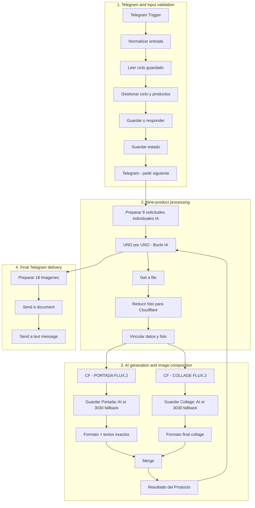

# Workflow architecture

This diagram describes the **existing public template**, not a redesign. The nodes and connections in the JSON were intentionally kept unchanged during the documentation stage.

**Note:** This is a conceptual illustration; the branches and loop are simplified. The authoritative execution graph is the n8n workflow JSON itself. In particular, the final delivery branch fires after the loop completes, not on every iteration.

## Input contract

- Start: exact Telegram message `iniciar ciclo de generación`.
- Reset: exact Telegram message `reiniciar ciclo`.
- Product: one **photo** with caption containing `Nombre:` and `ID:` on separate lines; optional `Precio:`, `Precio anterior:`, `Descuento:`.
- Access: a **single private chat ID** is allowed by `Normalizar entrada` after its placeholder is configured.
- State: an n8n Data Table keyed/filtering by `chat_id` stores the products as serialized JSON.

## Outputs and fallbacks

- Normal result: 9 cover images plus 9 collage images; captions describe product numbers.
- Error 3030: the affected cover/collage uses the original uploaded image instead of an AI-generated result, then proceeds to downstream image steps. This protects the process from that *specific* rejection, not all failure types.
- Final Telegram message includes a fallback count and the product positions affected.
- A fallback collage is **not** a set of four genuine photographs. Always review outputs before redistribution.

## Node configuration quick reference

See the sticky notes inside n8n, the [README configuration map](README.md#configuration-map) and the [Spanish setup guide](GUIA_CONFIGURACION.md). Do not modify paths, `chatId`/`fileId` expressions, or loop edges without tests.
